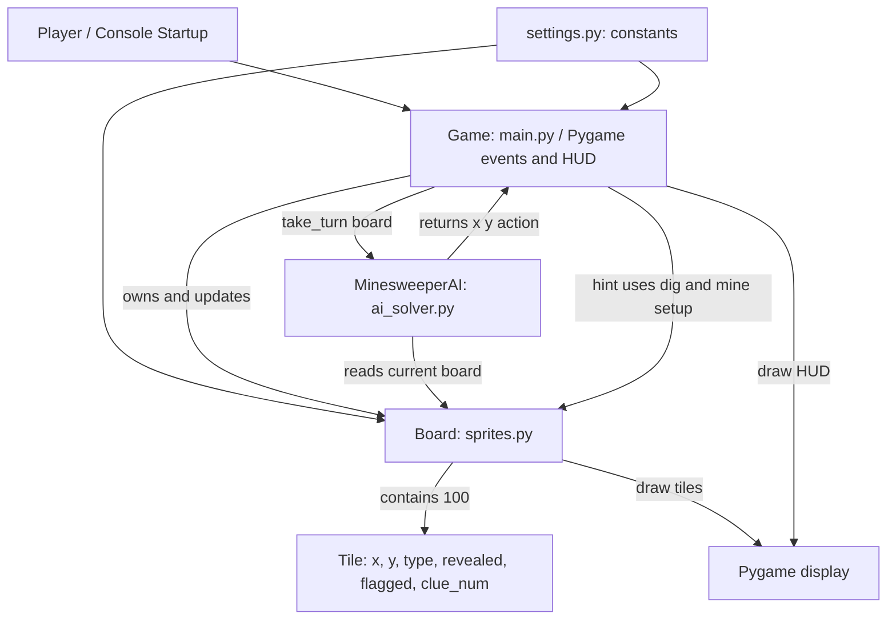
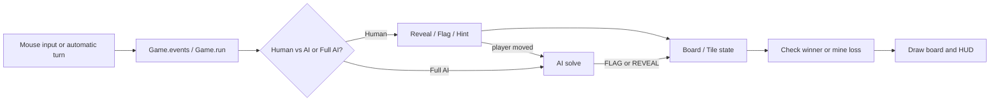
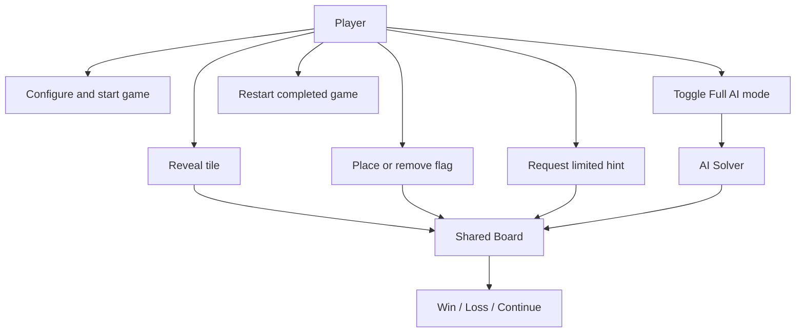
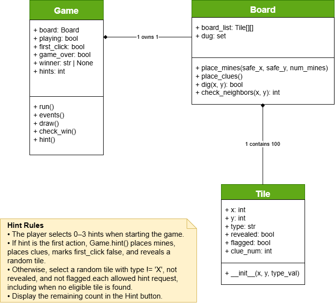
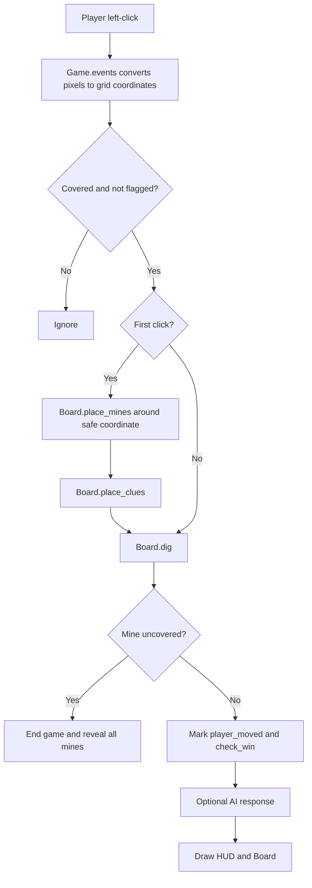
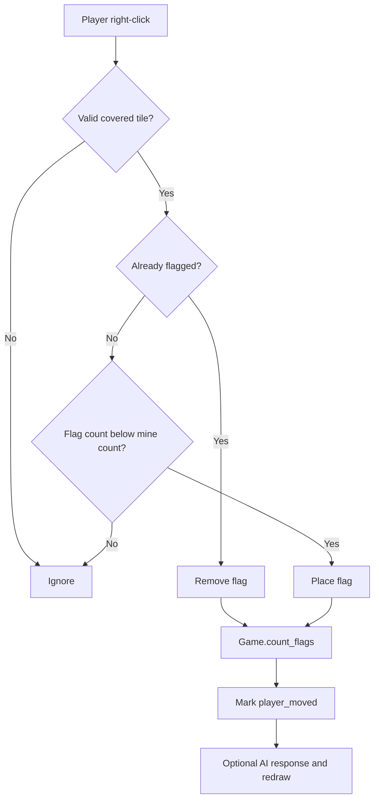
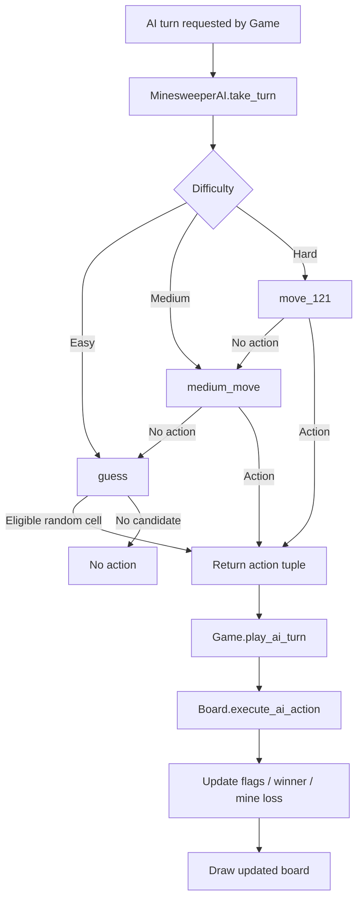
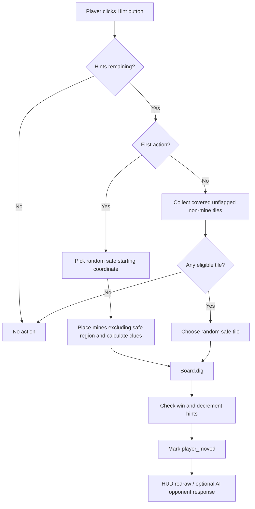
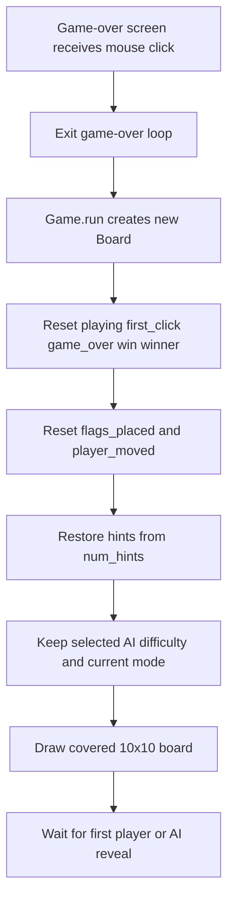
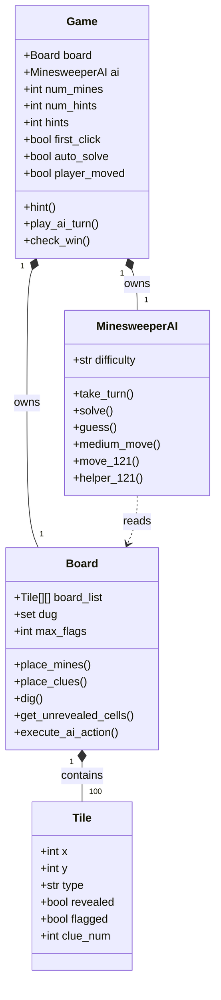

# Group 20

# Minesweeper
**Version:** 1.3  
**Date:** 10/11/2026  
**Document Identifier:** MS-SAP2-1.3

# Software Architecture Document
## Version 1.3

| Date | Version | Description | Author |
|------|---------|-------------|--------|
| 09/27/2026 | 1.0 | Initial creation of Project 2 Software Architecture Document | Ivan Kullaya |
| 09/28/2026 | 1.1 | Expanded initial architecture draft based on inherited Group 18 implementation and current Easy AI implementation | Ivan Kullaya |
| 10/10/2026 | 1.2 | Updated architecture to reflect final implementation and included Gael's UML Hint Feature Diagram | Ivan Kullaya |
| 10/11/2026 | 1.2 | Final review of architecture documentation to fix minor errors after reviewing code | Ivan Kullaya |

# Table of Contents

1. Introduction
   - 1.1 Purpose
   - 1.2 Scope
   - 1.3 Definitions, Acronyms, and Abbreviations
   - 1.4 References
   - 1.5 Overview
2. Architectural Representation
3. Architectural Goals and Constraints
   - 3.1 Architectural Goals
   - 3.2 Architectural Constraints
   - 3.3 Design Rationale
4. Use-Case View
   - 4.1 Use-Case Realizations
5. Logical View
   - 5.1 Overview
   - 5.2 Architecturally Significant Components
   - 5.3 Relationships Between Components
6. AI Solver Architecture
   - 6.1 Easy AI
   - 6.2 Medium AI
   - 6.3 Hard AI
7. Hint System Architecture
8. Data Flow
   - 8.1 Player Cell Reveal Data Flow
   - 8.2 Flag Data Flow
   - 8.3 AI Solver Data Flow
   - 8.4 Hint System Data Flow
   - 8.5 Game Reset Data Flow
9. Key Data Structures
   - 9.1 Board Representation
   - 9.2 AI-Related Data
   - 9.3 Relationship Between Data Structures
10. Interface Description
   - 10.1 Game Board
   - 10.2 Player Input
   - 10.3 AI Controls
   - 10.4 Hint Controls
   - 10.5 Game Information
11. Quality and Extensibility

# 1. Introduction

## 1.1 Purpose

This document describes the software architecture of the Minesweeper application maintained and extended by Group 20 for EECS 581 Project 2.

The original Minesweeper system was developed by Group 18 for Project 1 and inherited by Group 20 for Project 2. This document describes the organization of the inherited system as well as the architectural changes made by Group 20 to support the Project 2 requirements.

The inherited system is organized into separate modules responsible for game management, board and tile management, graphical configuration, and user interaction. Project 2 extends this architecture with an Artificial Intelligence (AI) solver supporting Easy, Medium, and Hard difficulty levels and a custom Hint System.

The purpose of this document is to provide developers with an understanding of the system's major components, interactions, data flow, key data structures, and design decisions so that the application can be maintained and extended in future development.

## 1.2 Scope

The Minesweeper application is a graphical implementation of Minesweeper developed using Python and the Pygame library. The inherited system uses a fixed 10x10 game board and allows the player to select between 10 and 20 mines when starting the application.

The inherited Project 1 system provides the following core functionality:
- A 10x10 Minesweeper board with columns labeled A-J and rows labeled 1-10.
- Random placement of the number of mines selected by the player.
- First-click safety that prevents mines from being placed on the first selected cell or its surrounding cells.
- Left-click cell revealing.
- Recursive revealing of empty regions.
- Right-click placement and removal of flags.
- Prevention of flagged cells from being uncovered.
- Calculation and display of adjacent mine counts.
- Detection of victory and loss conditions.
- Display of all mine locations after a loss.
- Restarting the game after a game has ended.
- Display of game status and remaining flags through the Pygame interface.

Project 2 extends the inherited system with three levels of AI behavior and a Hint System. The current source code implements Easy, Medium, and Hard AI selection, alternating human/AI turns, a Full AI mode, and a player Hint System. At startup the user selects 10–20 mines, 0–3 hints, and an AI difficulty. The Easy AI guesses among eligible covered cells; Medium adds clue-based flag/reveal rules; Hard additionally attempts a constrained 1-2-1 pattern. The Hint System reveals a safe cell and is not called by the AI.

## 1.3 Definitions, Acronyms, and Abbreviations

- **AI**: Artificial Intelligence
- **Cell/Tile**: An individual position on the Minesweeper board
- **Covered Cell**: A cell that has not yet been uncovered
- **Flag**: A marker indicating a cell believed to contain a mine
- **GUI**: Graphical User Interface
- **Hint**: A limited-use feature that reveals a safe, non-mine cell
- **Mine**: A hidden game element that results in a loss when uncovered
- **MVP**: Minimum Viable Product
- **Pygame**: Python library used to implement the graphical interface
- **1-2-1 Pattern**: A Minesweeper pattern used by the Hard AI to logically determine mine and safe-cell locations

## 1.4 References

- EECS 581 Project 2 – Enhance Another Team's Minesweeper System, Professor Hossein Saiedian, Fall 2026
- Group 18 Project 1 Minesweeper implementation
- Project source code (`src/`)
- External sources and generative AI assistance identified in individual source-file prologue comments.

## 1.5 Overview

The inherited Minesweeper application uses a modular, event-driven architecture. Pygame events are processed by the Game class in main.py, which coordinates player input, overall game state, board operations, win/loss detection, and screen updates.

Board-specific behavior is separated into sprites.py. The Board class maintains the collection of Tile objects and provides operations for mine placement, clue calculation, cell revealing, and drawing the board. Each Tile object maintains the state of one board location, including its coordinates, type, clue number, revealed state, and flagged state.

Configuration values are stored separately in settings.py, including board dimensions, tile size, window dimensions, frame rate, interface colors, and AI configuration values.

Project 2 additionally introduces ai_solver.py, which separates AI decision-making from the main game and board-management code. The AI implementation selects among Easy, Medium, and Hard strategies, with logical deductions and random fallback as applicable. The Game class coordinates when an AI turn occurs, while the Board class executes the AI's requested action.

# 2. Architectural Representation

The application is a modular, event-driven Python/Pygame program. main.py is the controller and UI layer; sprites.py owns the board model and drawing of tiles; ai_solver.py contains strategy decisions; settings.py defines configuration. Game owns one Board with exactly 100 Tile objects. Both human and AI actions modify this same board. Hints are implemented in Game, not in a separate module.

**Figure 1: High-level component architecture.** The arrows distinguish decision-making from board mutations. The AI reads board state and returns an action; Game.play_ai_turn() invokes Board.execute_ai_action().

**Figure 2: Main interaction and data flow.** In Human vs AI mode a valid human action causes one opponent response when enabled. In Full AI mode Game.run() requests an AI move on each active frame, subject to the configured delay.

# 3. Architectural Goals and Constraints

## 3.1 Architectural Goals

The primary architectural goals of the Project 2 Minesweeper system are:

- **Correctness:** All Project 1 Minesweeper functionality and Project 2 additions should operate according to the project requirements.
- **Maintainability:** Components should be organized so that functionality can be modified without unnecessarily affecting unrelated parts of the system.
- **Reliability:** The system should handle valid and invalid player/AI actions without crashing.
- **Usability:** The graphical interface should clearly communicate the board state, game status, AI controls, and Hint System.
- **Extensibility:** The system should support future additions to game logic, AI behavior, and interface features.
- **Modularity:** Major responsibilities should remain divided among separate modules and classes rather than being combined into a single source file.

## 3.2 Architectural Constraints

### Project 1 Constraints

The inherited system must continue satisfying the original Minesweeper requirements:
- The board contains exactly 10 rows and 10 columns.
- Columns are labeled A-J and rows are labeled 1-10.
- The player selects between 10 and 20 mines.
- Mines are placed randomly.
- Mine placement occurs after the player's first valid selection.
- The first selected tile and the eight surrounding positions are excluded from mine placement when those positions are within the board.
- Covered cells may be flagged and unflagged.
- Flagged cells cannot be uncovered.
- Empty cells recursively reveal neighboring cells.
- The game detects victory when all non-mine cells have been revealed.
- Uncovering a mine results in a loss and causes all mines to be displayed.
- The game can be restarted after completion.

### Project 2 Constraints

Project 2 adds the following architectural requirements:
- The inherited system must continue using Python and Pygame.
- All required Project 1 functionality must remain operational.
- Easy AI must randomly uncover valid hidden cells while avoiding revealed and flagged cells.
- Medium AI must apply the two required logical deduction rules before falling back to a random selection.
- Hard AI must include the Medium rules and additionally recognize the required 1-2-1 pattern.
- AI actions must operate on the same game board as player actions.
- Random AI selections must exclude revealed and flagged cells.
- The custom Hint System must identify and reveal a safe cell.
- Hint usage must be limited.

## 3.3 Design Rationale

The inherited Group 18 architecture was retained and extended rather than replaced. Project 2 requires Group 20 to use the same programming language and platform as the inherited Project 1 team. Because Group 18 implemented the Minesweeper system using Python and Pygame, Group 20 continued development using Python and Pygame.

The existing modular structure was also retained where possible to reduce unnecessary changes to working Project 1 functionality. The inherited system separates major responsibilities among main.py, sprites.py, and settings.py. main.py manages the overall game and player interaction, sprites.py manages the board and individual tiles, and settings.py contains shared configuration values.

For Project 2, the architecture was extended with ai_solver.py to separate AI decision-making from the existing game and board logic. This allows the AI strategies to be developed without placing all AI logic directly into the inherited Project 1 components. The AI determines which action should occur, while the existing game and board components remain responsible for executing actions and updating the game state.

This separation also supports the three required AI difficulty levels. Easy AI uses random selection, while Medium and Hard AI can add additional decision-making rules while continuing to interact with the same board and game components.

The Hint System is implemented as Game.hint() in main.py and uses the existing Board to reveal a safe cell. A mode toggle in the Pygame HUD selects Human vs AI or Full AI; the AI uses the same Board in either mode. The hint is a player action, not an AI strategy.

# 4. Use-Case View

The player chooses mine count (10–20), hint count (0–3), and AI difficulty (Easy, Medium, Hard) using console prompts. The player can reveal a tile, flag/unflag a tile, request a hint, toggle Full AI mode, and restart after a finished game. The AI opponent is an internal actor that performs flag or reveal actions on the same board.

**Figure 3: Use-case overview.** This is an interaction overview rather than a strict UML use-case diagram; the separate custom-feature class UML is reproduced in Section 7.4.

## 4.1 Use-Case Realizations
The console validates the selected mine count, hint count, and difficulty, then constructs Game(num_mines, num_hints, difficulty). Game.run() creates a fresh Board on each new round, resets the winner, flag count, first_click, player_moved, and remaining hints. Difficulty and mode persist across rounds unless the program is restarted or the mode button is toggled.

### Start or Reset Game
A left-click is translated from screen pixels to (col, row). The event handler rejects out-of-board, flagged, and already-revealed tiles. On the first reveal, place_mines() excludes the selected cell and its adjacent cells, then place_clues() calculates numbers. Board.dig() reveals the tile, recursively expanding blank regions. The Game checks for a mine loss or victory.

### Uncover Cell
A left-click is translated from screen pixels to (col, row). The event handler rejects out-of-board, flagged, and already-revealed tiles. On the first reveal, place_mines() excludes the selected cell and its adjacent cells, then place_clues() calculates numbers. Board.dig() reveals the tile, recursively expanding blank regions. The Game checks for a mine loss or victory.

### Place or Remove Flag
A right-click on an unrevealed tile toggles Tile.flagged. The player cannot place more flags than the selected mine count. Game.count_flags() updates the HUD. Valid flag actions can trigger the AI opponent's next turn.

### Use AI Solver
Game.play_ai_turn() calls MinesweeperAI.take_turn(board), which delegates to solve() and returns zero or one action as a list. Game passes each (col,row,action) to Board.execute_ai_action(), updates flag counts, and checks for loss or victory.

### Easy AI Turn
guess() randomly chooses a cell returned by Board.get_unrevealed_cells() and returns a REVEAL action.

### Medium AI Turn
medium_move() scans revealed clue tiles and classifies their neighboring cells as flagged or hidden. If hidden + flagged == clue, it flags a hidden neighbor; if flagged == clue, it reveals a hidden neighbor. It returns one action per turn. If no rule applies, solve() calls guess().

### Hard AI Turn
solve() attempts move_121() first, then medium_move(), then guess(). move_121() scans horizontal and vertical revealed 1-2-1 clues and checks adjacent candidate cells through helper_121(). A qualifying pattern flags outer candidates and eventually reveals the center candidate.

### Request Hint
In human-controlled mode, the player clicks Hint (n). If hints remain and this is the first action, Game.hint() randomly chooses a safe starting coordinate, places mines and clues around it, and reveals it. Otherwise it selects an unrevealed, unflagged, non-mine tile and reveals it. A successful hint consumes one use and counts as a player action.

### Victory
Game.check_win() counts non-mine tiles that remain unrevealed. If none remain, it ends the game and records the supplied winner (`player` or `ai`).

### Loss
Revealing a mine ends the game and exposes all mines. If the AI uncovers a mine in Human vs AI mode, the player is recorded as the winner; in Full AI mode the result is ai_lost. Full AI can also end in a stalled state if no action is available or a flag limit prevents an AI flag.

# 5. Logical View

## 5.1 Overview

The current Project 2 implementation consists primarily of the following source files:

### `main.py`

Responsible for:

- Initializing Pygame.
- Creating and controlling the application window.
- Creating and resetting the Board.
- Processing player mouse input.
- Managing first-click behavior.
- Coordinating player and AI turns.
- Maintaining overall game state.
- Tracking flags.
- Detecting win and loss conditions.
- Updating the graphical display.
- Restarting the game after completion.

### `settings.py`

Responsible for:

- Board dimensions.
- Tile dimensions.
- Window dimensions and margins.
- Frame-rate settings.
- Window title.
- Interface colors.
- Clue-number colors.
- AI autoplay configuration.
- AI move delay.

### `sprites.py`

Responsible for:

- Defining the Tile class.
- Defining the Board class.
- Creating the collection of Tile objects.
- Random mine placement.
- Creating the first-click safe area.
- Calculating clue values.
- Revealing cells.
- Recursive revealing of empty areas.
- Tracking Tile reveal and flag states.
- Drawing the board.
- Identifying valid cells for AI actions.
- Executing AI reveal and flag actions.

### `ai_solver.py`

Responsible for:

- Defining the MinesweeperAI class.
- Determining AI actions.
- Selecting valid random cells for Easy AI.
- Providing the decision-making location for Medium and Hard AI strategies.

### Hint System

- The Hint System is implemented in Game.hint() within main.py, using the same Board and Tile objects as player and AI actions.
- The HUD displays a clickable Hint (n) button.

## 5.2 Architecturally Significant Components

### User Interface

The user interface is implemented using Pygame. The Game class manages the overall display while the Board class draws the individual tiles.

The interface communicates the current state of the game by displaying the board, coordinate labels, covered and revealed cells, flags, clue numbers, mines, remaining flags, and game status.

### Board Management

The Board class maintains the Minesweeper board as a two-dimensional collection of Tile objects.

The Board is responsible for creating tiles, placing mines, creating the safe region around the first selected cell, calculating clue numbers, uncovering cells, recursively uncovering empty areas, and rendering the board.

### Tile Management

Each location on the board is represented by a Tile object. A Tile stores its board coordinates, underlying type, clue number, revealed state, and flagged state.

The Tile representation allows the different parts of the application to obtain the complete state of a board location through one object.

### Game State Management

The Game class manages the overall state of the current game. This includes whether gameplay is active, whether the first click has occurred, the selected number of mines, number of flags placed, game-over status, victory status, and winner.

Project 2 additionally tracks whether the player has performed an action requiring an AI response.

### AI Solver

AI decision-making is separated into the MinesweeperAI class in ai_solver.py.

The AI receives the current Board and determines an action. Easy AI selects randomly among valid covered and unflagged cells; Medium evaluates neighboring clues; Hard checks 1-2-1 patterns before the Medium rules.

The same AI class already implements Medium and Hard behavior in medium_move(), move_121(), and helper_121(), without replacing the Board representation.

### Hint System

The Hint System will provide limited assistance by selecting a covered safe tile and revealing it for the player.

The Hint System is implemented in Game.hint(). On a first-action hint it initializes mines and clues around a randomly chosen safe coordinate, reveals that tile, and consumes one hint. Later hints randomly select a covered, unflagged, non-mine tile. It uses Board.dig(), checks victory, decrements the remaining count, and marks player_moved so the opponent can respond.

### Win/Loss Management

Win and loss conditions are coordinated by the Game class.

A win occurs when no safe tiles remain covered. A loss occurs when a mine is uncovered. Project 2 additionally identifies whether a completed game resulted from the player's or AI's actions.

### Game Reset

A new game creates a new Board and resets the relevant game-state values. Mine placement is delayed until the player's first valid selection so the first-click safe region can be established.

## 5.3 Relationships Between Components

main.py acts as the primary coordinator between the player, Pygame interface, Board, and AI solver.

Player mouse events are received by the Game. Valid board coordinates are then used to modify Tile state through the Board.

On the first valid reveal, the Game requests mine placement and clue calculation before revealing the selected tile. Later reveals use the existing Board state.

The AI receives the Board so that it can determine which cells are eligible for an action. After making a decision, the AI returns an action to the Game. The Game then passes that action to the Board, which modifies the appropriate Tile.

settings.py provides shared configuration values used by the other components. This prevents constants such as board dimensions, colors, and AI settings from being repeatedly defined throughout the application.

The Board and Game display their current state through Pygame. As Tile and game-state values change, subsequent screen updates reflect those changes.

Game.hint() directly examines Board.board_list and calls Board.place_mines(), Board.place_clues(), and Board.dig(). The AI does not call the hint feature. The game redraws the hint count in the Pygame HUD.

# 6. AI Solver Architecture

## 6.1 Easy AI

### Purpose

The Easy AI provides the simplest automated Minesweeper behavior.

### Behavior

- Identifies valid hidden cells.
- Excludes uncovered cells.
- Excludes flagged cells.
- Randomly selects one remaining valid cell.
- Returns a REVEAL action for the selected cell.
- The Board executes the action using the existing cell-reveal functionality.

### Relevant Functions/Classes

| Function/Class | Purpose |
|:---:|:---:|
| MinesweeperAI | Encapsulates AI decision-making. |
| take_turn() | Requests an AI move and returns the action to the Game. |
| solve() | Main decision point for selecting an AI action. |
| guess() | Randomly selects an eligible covered cell. |
| Board.get_unrevealed_cells() | Returns cells that are neither revealed nor flagged. |
| Board.execute_ai_action() | Executes a reveal or flag action requested by the AI. |
| Game.play_ai_turn() | Coordinates the AI turn and handles the resulting game state. |

## 6.2 Medium AI

### Purpose

The Medium AI attempts to make logical moves using information visible on the board before falling back to a random selection.

### Rule 1 – Flag Mines

If the number of hidden neighbors of a revealed cell equals the cell's displayed number, all hidden neighbors are flagged.

### Rule 2 – Reveal Safe Cells

If the number of flagged neighbors equals the displayed number, all other hidden neighbors are safe and may be uncovered.

### Random Fallback

If neither rule produces a valid action, the AI performs the same random selection behavior used by Easy AI.

### Relevant Functions/Classes

| Function/Class | Purpose |
|:---:|:---:|
| medium_move(board) | Inspect revealed clues and return a single logical action or None. |
| solve(board) | Route Medium difficulty to medium_move(), then guess(). |
| guess(board) | Choose a random unflagged, unrevealed tile when no deduction exists. |

## 6.3 Hard AI

### Purpose

The Hard AI extends Medium AI behavior by recognizing the required 1-2-1 Minesweeper pattern.

### Behavior

1. Attempt Medium AI rules.
2. Search for a valid 1-2-1 pattern.
3. Determine mine and safe-cell positions from the pattern.
4. Flag logically identified mines.
5. Uncover logically identified safe cells.
6. If no logical move exists, perform a random valid selection.

### Relevant Functions/Classes

| Function/Class | Purpose |
|:---::---:|
| move_121(board) | Find horizontal/vertical 1-2-1 clue patterns and try candidate orientations. |
| helper_121(board, pos_1, pos_2, pos_3, clue_positions) | Validate candidate pattern and return one flag/reveal action. |
| medium_move(board) | Apply standard clue deductions when no 1-2-1 action is found. |
| guess(board) | Random fallback if neither logic stage yields an action. |

# 7. Hint System Architecture

## Purpose

The Hint System provides limited assistance to the player during a Minesweeper game.

When the player requests a hint, the system identifies a covered cell that does not contain a mine and safely reveals that cell.

The number of hints available during a game is limited so that the feature provides assistance without removing the challenge of the game.

## Behavior

1. The player requests a hint.
2. The system determines whether any hints remain.
3. Eligible covered cells are identified.
4. Mine cells are excluded.
5. A safe eligible cell is selected.
6. The selected cell is revealed.
7. The remaining hint count is decreased.
8. The interface is updated.

## Relevant Functions/Classes

| Function/Class | Purpose |
|:---:|:---:|
| Game.hint() | Select and reveal a safe tile, consume a hint, and record the player's move. |
| Game.events() | Detect clicks on the hint button and block them during Full AI mode. |
| Board.place_mines() / place_clues() | Initialize the board if a hint is the first action. |
| Board.dig() | Reveal the selected safe tile and recursively expand blanks. |
| Game.check_win() | Detect victory after a hint. |
| Game.draw() | Draw the Hint (n) button and remaining count. |

## UML Diagram

**Figure 4: Custom Hint System UML diagram supplied by the team.** Game owns one Board, and Board contains 100 Tile objects. The diagram documents Game.hint() and the first-action / later-action rules.

# 8. Data Flow

The Project 2 Minesweeper application uses event-driven data flow. Player actions originate through the Pygame interface and are processed by the Game. The Game coordinates Board operations and AI actions, while changes to Tile and game-state data are reflected during subsequent display updates.

## 8.1 Player Cell Reveal Data Flow

When the player left-clicks a valid covered tile, the Pygame event handler determines the corresponding board coordinates.

On the first valid reveal, the Board places mines while excluding the safe region surrounding the selected cell. Clue values are then calculated before the cell is revealed.

Board.dig() processes the selected tile. Empty tiles may cause neighboring cells to be recursively uncovered. After the reveal, the Game checks for a loss or victory and updates the display.

**Figure 5: Player reveal data flow.** Empty-tile reveals recursively expand to adjacent tiles through Board.dig() and its dug set.

## 8.2 Flag Data Flow

When the player right-clicks a covered cell, the Game determines the corresponding Tile and verifies that the cell is eligible to be flagged.

If the cell is currently unflagged and additional flags are available, its flagged state is set to true. If it is already flagged, the flag is removed.

The Game recounts the number of flags currently placed and the Board's next display update reflects the new Tile state.

**Figure 6: Player flag data flow.** The flag state is stored on each Tile, not in a separate flag grid.

## 8.3 AI Solver Data Flow

An AI turn begins after the Game determines that the player has completed a valid action and AI autoplay is enabled.

The Game requests an action from MinesweeperAI. The selected AI strategy examines the current Board and returns one or more actions.

Easy AI selects randomly among eligible cells. Medium AI will first attempt its required logical rules, while Hard AI will additionally attempt the 1-2-1 pattern. If no logical action is available, Medium and Hard fall back to random selection.

The resulting action is sent to Board.execute_ai_action(), which modifies the Board. The Game then updates flag counts if necessary and checks the resulting win/loss state.

**Figure 7: AI data flow.** A returned move is a three-element tuple (col, row, 'FLAG' or 'REVEAL'); take_turn() wraps it as a one-element list. Human vs AI requests a response after valid player actions; Full AI requests a turn each active frame. AI_MOVE_DELAY_MS slows the execution of each action.

## 8.4 Hint System Data Flow

The Hint System data flow begins when the player requests a hint. The system verifies that a hint remains available and then identifies eligible covered safe cells.

A safe cell is selected and revealed, the remaining hint count is reduced, and the new state is displayed.

**Figure 8: Hint data flow.** The Hint System is independent of MinesweeperAI; it modifies the same Board using Board.dig().

## 8.5 Game Reset Data Flow

A new game begins by creating a new Board and resetting game-state information.

The reset process clears the previous board, mines, revealed states, flags, game result, first-click status, AI-turn state, and other information associated with the previous round. Project 2 Hint System state will also be reset once that feature is integrated.

The new game then waits for the player's first valid reveal before placing mines.

**Figure 9: Reset data flow.** Mine locations are not reused because a new Board is created each round.

# 9. Key Data Structures

The Project 2 Minesweeper system uses an object-based representation of the game board. A Board contains a two-dimensional collection of Tile objects, and each Tile stores the state associated with an individual board position.

| Structure / Variable | Type | Description |
|:---:|:---:|:---:|
| board_list | 2D list of Tile objects | Represents the Minesweeper board. |
| Tile.type | String | Identifies the underlying tile as empty, mine, or clue. |
| Tile.revealed | Boolean | Records whether a tile has been uncovered. |
| Tile.flagged | Boolean | Records whether a tile is currently flagged. |
| Tile.clue_num | Integer | Stores the number of adjacent mines for a clue tile. |
| Board.dug | Set | Stores coordinates visited during recursive revealing. |
| Game.num_mines | Integer | Stores the selected number of mines. |
| Game.flags_placed | Integer | Stores the current number of placed flags. |
| Game.first_click | Boolean | Records whether mine placement is still required. |
| Game.playing | Boolean | Records whether active gameplay is occurring. |
| Game.game_over | Boolean | Records whether the game has ended. |
| Game.win | Boolean | Records whether a victory has occurred. |
| Game.winner | String/None | Identifies the player or AI as the winner. | 
| Game.player_moved | Boolean | Determines whether an AI response should occur. |

## 9.1 Board Representation

The game board is stored in Board.board_list as a two-dimensional collection of Tile objects.

Each Tile contains its x- and y-coordinates as well as the state needed to represent that board location.

Mines are represented by a Tile type of 'X'. Empty tiles initially use '.'. Non-mine cells adjacent to one or more mines are represented as clue cells, with their adjacent mine count stored in Tile.clue_num.

A Tile's revealed state is represented by Tile.revealed, while its flag state is represented independently by Tile.flagged.

This representation allows the Board, Game, display logic, and AI to access information about a board position through the same Tile object.

## 9.2 AI-Related Data

The Easy AI does not maintain a separate copy of the board. Instead, the current Board object is supplied to the AI when a decision is requested.

Board.get_unrevealed_cells() creates a temporary list of coordinates representing cells that are neither revealed nor flagged. MinesweeperAI.guess() randomly selects from these coordinates.

An AI action contains an x-coordinate, y-coordinate, and action type. The current Easy AI returns a REVEAL action. The Board's AI-action interface also supports FLAG, allowing Medium and Hard AI strategies to perform logical flagging.

## 9.3 Relationship Between Data Structures

The Board owns the collection of Tile objects representing the current game. Each Tile stores its own mine/clue type, reveal state, flag state, and clue number.

The Game owns the Board and maintains information about the overall game state. The AI reads the Board when selecting an action but does not currently maintain an independent copy of the board.

**Figure 10: Key class and data-structure relationships.** The Hint System is Game.hint(), not a separate class. The focused UML in Section 7.4 shows the custom feature without the AI methods.

# 10. Interface Description

## 10.1 Game Board

The graphical game board is displayed using Pygame and consists of a 10x10 collection of tiles.

Columns are labeled A through J and rows are labeled 1 through 10 to identify board coordinates.

Covered tiles are displayed without exposing their underlying contents. Revealed clue tiles display their number of adjacent mines, while revealed empty tiles display no clue number. Flagged tiles display a flag indicator.

When a mine is revealed, the mine locations are displayed to indicate the loss condition.

## 10.2 Player Input

| Input | Result |
|:---:|:---:|
| Console: mine count 10–20 | Sets num_mines. Invalid input is rejected. |
| Console: hint count 0–3 | Sets num_hints. Invalid input is rejected. |
| Console: difficulty 1/2/3 | Chooses Easy, Medium, or Hard. |
| Left-click covered unflagged tile | Reveals tile; first reveal initializes mines and clues. |
| Right-click covered tile | Adds/removes flag within mine-count limit. |
| Click Hint (n) | Uses one available safe-reveal hint in human mode. |
| Click Mode: ... | Toggles Human vs AI / Full AI. |
| Mouse click on game-over screen | Starts a new round; clicking mode also toggles the mode. |
| Window close | Quits Pygame. |

## 10.3 AI Controls

The difficulty is selected once through console prompts and stored in Game.ai.difficulty.

The Pygame HUD displays Playing | AI: <difficulty> in Human vs AI mode or Full AI solving | AI: <difficulty> in Full AI mode.

Clicking the mode button changes Game.auto_solve. In Human vs AI mode, AI_AUTO_PLAY_ENABLED in settings.py determines whether the AI responds after a valid player action.

In Full AI mode, Game.run() calls play_ai_turn() repeatedly without requiring a human move. AI_MOVE_DELAY_MS (850 ms in the supplied settings) pauses between AI actions.

## 10.4 Hint Controls

The console accepts 0–3 hints. Game.draw() displays Hint (n) below the board. Clicking it in human mode calls Game.hint(), which safely reveals an eligible tile and decrements hints. If zero hints remain, nothing happens. Full AI mode ignores the hint button.

## 10.5 Game Information

The interface currently displays information necessary for the player to understand the current game state, including:

- Remaining flags.
- Game status.
- Board coordinates.
- Revealed clue values.
- Flagged tiles.
- Win/loss information.
- Player/AI result information when AI autoplay is active.

The HUD shows game status, selected AI difficulty, number of mines, flags remaining, board coordinates, remaining hints, and current mode. End messages distinguish player victory, AI victory, AI mine loss in Full AI mode, a stalled Full AI solver, and general game over.

# 11. Quality and Extensibility

### Maintainability

The application separates UI/game coordination (`main.py`), board and tile representation (`sprites.py`), AI strategies (`ai_solver.py`), and constants (`settings.py`). Future teams can extend the AI without rewriting the Board or Pygame drawing. The Hint System reuses Board.dig() and the existing Tile representation.

### Reliability

Mouse-to-grid conversion checks bounds, normal player reveals reject flagged/revealed tiles, and the Board prevents flagged cells from being uncovered. Board.execute_ai_action() validates coordinates and caps AI flags. The first-action safe zone prevents a mine on the initial reveal. Input loops reject invalid startup values. These are code-level protections; they do not substitute for a full test suite.

### AI Extensibility

solve() routes decisions by difficulty. New strategies can be added as methods returning (x,y,action) or None, using guess() as a fallback. Because Game.play_ai_turn() consumes the same action format, a new difficulty need not alter the UI or Board action executor.

### Feature Extensibility

New player features can be connected through Game.events() and rendered in Game.draw(), while reusing the shared Board methods. The hint implementation illustrates this pattern, and its remaining count is reset at the start of each round.

### Known Architectural Limitations

- **Shared controller responsibilities:** `Game` manages Pygame events, status, AI coordination, and hints; future refactoring could isolate UI/controller and hint logic into separate classes.

---

© Group 20, 2026
